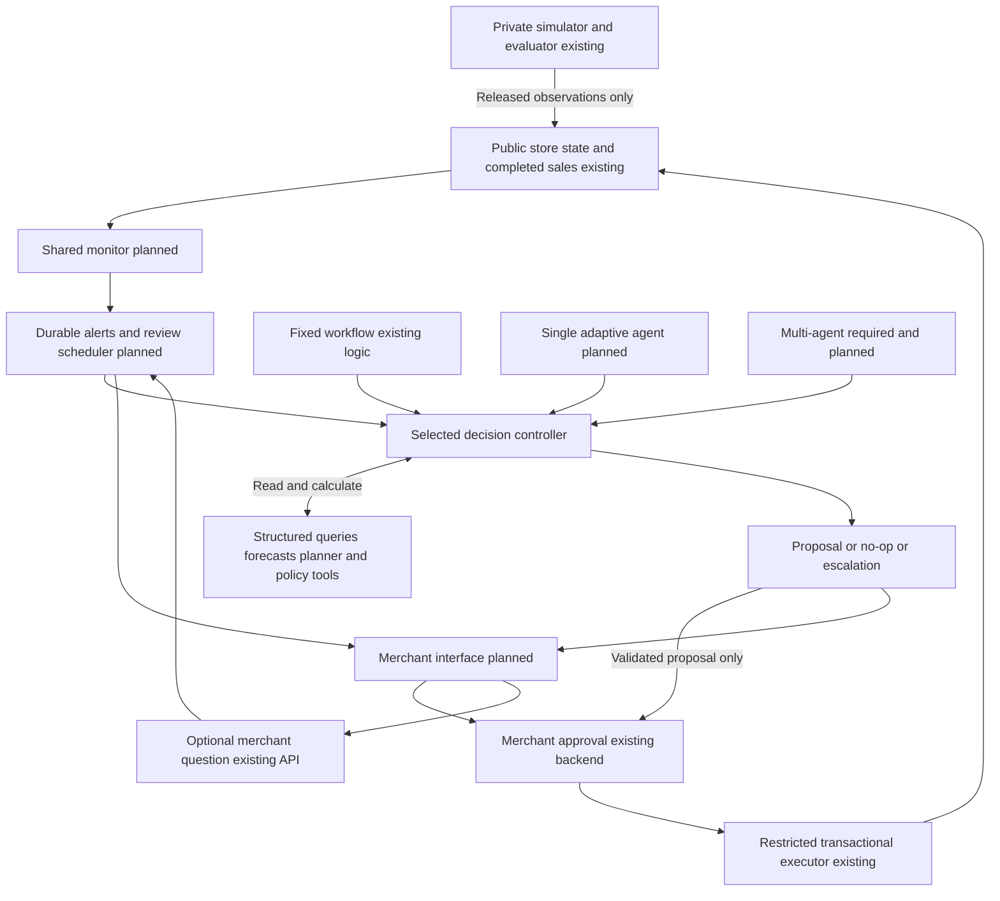

# Current architecture and next implementation steps

Status reviewed November 19 2026. This is the working implementation plan for the confirmed proactive approach. The original Phase 0 to 2 foundations and fixture flows remain implemented locally. The proactive application, including the integrated fixed-controller path, is not implemented. All Phase 3A to 3F increments below are pending. No LLM API calls have been made. The last recorded full software check was November 18: 137 tests, lint, formatting, and smoke passed.

## Agreed product and scope

Build a proactive merchant decision assistant. It monitors permitted store observations, identifies emerging inventory or pricing concerns, investigates them, and presents evidence-supported recommendations without requiring the merchant to ask first. The merchant approves an exact action bundle before the executor changes the store. Merchant questions remain an optional way to initiate an investigation.

Required comparison: fixed deterministic numerical workflow versus single adaptive agent versus bounded multi-agent system. All three use the same monitoring logic, structured data, numerical tools, business rules, action windows, and approval/execution service. The existing rules implementation remains a development reference. Build the single-agent path first, then the required supervisor and specialists.

Document RAG, numerical RAG, embeddings, vector databases, document ingestion, and the proposed written-policy exception prototype are excluded. Business-policy lookup remains in scope: exact versioned records and deterministic validation, not document search.

Keep ten products, one warehouse, two existing suppliers, price changes and purchase orders, and the option of no change. Historical forecasting and simulated business evaluation remain separate experiments. The project places no real orders or payments.

## Current readiness

The fixed numerical algorithm and offline 28-day harness are implemented. The rules-based Phase 2 demo exercises real approval, execution, and durable advancement with a scripted merchant. Neither demonstrates the new monitor, automatic investigation scheduler, persisted fixed-controller episode, or adaptive LLM worker. Those are the next implementation work, not features already available.

## Architectural change

Earlier application entry: merchant question, investigation, proposal, approval, execution. The revised default entry is a published store observation, monitoring, a scheduled investigation, and a proactive recommendation. The action boundary stays the same.

Select one controller for each live store run or evaluation copy. The diagram does not mean that all controllers issue independent purchases into the same store. Controllers cannot approve themselves or inspect private simulator truth.

## What is reused and what is new

| Component | Implemented behavior to reuse | Further work |
| --- | --- | --- |
| Historical data | Local M5 panel, splits, provenance, cutoff-safe reads | Preserve final-test boundary |
| Store simulator | Daily transitions, costs, deliveries, checkpoints, released observations | Publish a reliable observation event or monitor cursor |
| Numerical tools | Forecasts, scoped history/supplier reads, candidate planner, validator | Common observation adapter and explicit exact policy-read tool |
| Fixed controller | Snapshot, forecast, compare, validate sequence | Application worker adapter and persisted 28-day run |
| Approval and execution | Identity, immutable proposals, hash approval, idempotent executor, receipts | Reuse unchanged authority boundary for all controllers |
| Monitoring | Not implemented | Risk detectors, alert records, lifecycle, deduplication |
| Investigation scheduling | Human-requested queued run creation exists | Restricted automatic trigger identity, leased jobs, worker recovery |
| Adaptive agent | Not implemented | Course-gateway adapter, tool loop, structured outcomes, budgets, checkpoints |
| Merchant interface | Not implemented | Alerts, investigations, approval, receipts, outcomes |

Current investigation creation requires a human bearer session, and existing workers process executor and simulator jobs only. Automatic monitoring therefore needs a properly scoped service identity and new migrations; it must not reuse a long-lived merchant token or receive approval rights.

## Monitoring behavior

Check committed public observations after each simulated day and after released supplier/order updates. Use forecasts, completed fulfilled sales, stock, and published ETAs. Never use hidden demand, actual future arrival dates, private elasticity, seeds, or evaluator-only ledgers.

Start with a few transparent alerts:

- Expected stock coverage ends before an incoming shipment or normal replenishment could arrive.
- A published incoming-order ETA has moved or an order is visibly overdue.
- Recent completed sales substantially exceed the available forecast, with minimum evidence requirements.

Define thresholds and edge cases before measuring performance. Zero demand, existing inbound stock, intermittent sales, and sales limited by stock availability must not create invented certainty.

Persist each alert's tenant, episode, product/order, risk type, evidence, observed day/version, severity, and lifecycle. Update an existing unresolved issue instead of emitting a fresh notification for every snapshot. Closing an alert and deduplicating a delivery or job are different operations.

Monitoring is ordinary code, shared by all three controllers. It does not require GPT to run continuously. A selected controller investigates at the common review points.

## Common clock and investigation budget

Retain reviews on days 1, 4, 7, and 10 inside the fourteen-day decision window. Keep all four scheduled reviews for all three methods, even if the current alert batch is empty, so the existing fixed baseline is not silently changed into a different policy. Any method can return no-op.

Daily monitoring maintains evidence and alerts between reviews. A review uses the latest visible snapshot and one batched investigation per store, episode, controller, and review day. This gives at most four scheduled investigations per policy episode. Repeated events, retries, and execution-created versions must not create extra model budgets.

Days 15 to 28 remain continuation: deliveries, sales, holding costs, and accounting continue, with no new purchase/price decisions or extra paid investigation loop. A future daily-intervention experiment would require the same new cadence for every controller and a revised budget.

Before proposal submission, approval, and execution, recheck current snapshot, simulated day, policy version, and expiry. An alert is evidence, not permission to execute an old plan. Do not hold a database transaction open during model calls. In automated evaluation, finish the review and mock-approval/outcome step before advancing the simulated day. In the human UI, show that advancing can invalidate a pending proposal.

## Phase 3A Public observations and shared monitoring

Build the common observation adapter from training-period history, completed simulated sales, the visible snapshot, and exact active business policy. Make its tenant, historical cutoff, simulated day, and snapshot version explicit.

Add durable alert storage and deterministic detector functions. Process committed observations through an outbox or robust version cursor, including the initial day-one state. Restarting must not skip observations or create duplicate issues. Do not call an LLM in this increment.

Exit gate: a known development shortage or released delay creates one correct alert with traceable public evidence; quiet cases remain quiet; repeats and restarts behave correctly; another tenant and hidden future data are inaccessible.

## Phase 3B Durable investigation scheduling

Add a tenant-bound monitor/scheduler database role with limited observation, alert, and investigation-job permissions. Add typed source metadata so automatic alerts and merchant requests are distinguishable. Add leased investigation jobs with retry limits, episode/review deduplication, and terminal states for proposal, no-op, escalation, timeout, and failure.

The scheduler batches alerts at each common review. A changed snapshot may require refreshed observations or a bounded retry, but never a reset of accumulated model usage. Existing human approval rights remain separate.

Exit gate: an automatic review runs without a merchant question or reused human token, appears once, survives worker restart, and cannot approve or execute a purchase.

## Phase 3C Fixed workflow through the complete application path

Wrap the existing fixed controller in an investigation worker using the common observations and jobs. Persist its tool traces and final outcome. Valid proposals go through the existing immutable proposal, authorized mock merchant for experiments, executor, receipt, and simulator checkpoint path.

Run a complete 28-day persisted development episode. It must include all four reviews, no-op handling, day advancement, restart/retry checks, and reconciled results. The existing six-run numerical harness remains a historical development reference; it is not yet this integrated path.

Exit gate: the proactive deterministic application completes a reproducible episode with no LLM call and no privileged controller write shortcut. This is the exact application boundary the adaptive agent will reuse.

## Phase 3D Single adaptive agent

The user confirmed a course-provided model gateway, not a direct OpenAI account. Verify its base URL, authentication mechanism, approved model identifier, tool/structured-output compatibility, usage reporting, limits, and billing before selecting the adapter transport or making live calls. Never place credentials in reports or traces.

Add a provider adapter and a bounded tool loop. The agent receives a review objective plus scoped alert evidence, chooses permitted tools, and returns a structured proposal, justified no-op, or escalation. Arithmetic, forecasts, policy enforcement, and authorization stay in tools and services. A diagram label or checkpoint table alone is not a completed adaptive workflow.

Persist steps, evidence references, consumed budgets, and recoverable state. Reserve allowance before paid requests and count reasoning/output, retries, and uncertain interrupted requests conservatively. Exactly-once purchase execution does not imply exactly-once provider billing; interrupted external calls require explicit handling.

Initial proposed caps remain six model calls, 18,000 cumulative input tokens, 3,000 cumulative output tokens, twelve tools including three comparisons, and 90 seconds excluding human wait per investigation. Enforce episode and project limits as well. Pilot ten development investigations, measure useful outcomes, cost, and latency, then freeze or revise the settings before final evaluation.

Exit gate: real gateway calls produce grounded valid proposals, justified no-ops, or safe escalations; restart does not repeat business effects or reset budgets; invalid tools and model failures remain visible.

Status (implemented in `llm.py` and `agent.py`): Portkey gateway, model `@30875-fall26-openai/gpt-5-nano`, reasoning effort low, 1,200 output tokens per call (also the amount charged for an interrupted call). The agent may adopt, trim, or edit the compared bundle; every proposal must pass `validate_plan` and only touch forecast SKUs. Pilot (12 live investigations, three development scenarios): 12/12 validated proposals, 3-5 model calls, 8.2k-15.8k input and 0.9k-1.7k output tokens per investigation, no budget exhaustion, about 1.5 US cents in total. Caps are frozen at six model calls, 18,000 input tokens, 3,000 output tokens, twelve tools including three comparisons, and 90 seconds.

## Phase 3E Required bounded multi-agent system

After the single-agent gate, implement and trial a supervisor with inventory and pricing specialists using the same tools and observations. The supervisor reconciles one final proposal under shared cash. Specialists cannot approve or execute. Count all team calls, tokens, tools, retries, and coordination toward one aggregate budget. No RAG or extra document agent is added.

Status (implemented in `multi_agent.py` on the shared conversation engine in `agent.py`): the supervisor delegates through `ask_inventory_specialist` / `ask_pricing_specialist` only when needed; specialists start from charged briefing forecasts for their focus SKUs, use narrow tools, and can only return role-restricted recommendations (purchase orders or prices). The supervisor owns `compare_plans`, `validate_plan`, and `submit_decision`, keeps an output reserve for its final turn, and each consultation uses at most two model calls. All calls, tokens, tools, delegations, and retries count toward one team budget. A first pilot under the single agent's caps escalated 5-9 of 12 reviews because three reasoning roles exhausted 3,000 output tokens, so the team's output cap was raised to 5,000 (all other caps unchanged; recorded on every conversation trace; must be disclosed). Pilot at 5,000 (12 live investigations): 8 proposals, 2 no-ops, 2 budget escalations; 4-6 model calls, 12.4k-16.8k input and 2.6k-5.0k output tokens per investigation; about 2.6 US cents in total; 83-107 s per 28-day episode.

This arm is required. Freeze the bounded team architecture before final runs and retain negative and failed results. Keep only two specialists and one final supervisor proposal so the implementation remains reviewable. Its exit gate is a durable team investigation with one feasible outcome, aggregate usage accounting, no independent specialist spending, and recovery without duplicate business effects.

## Phase 3F Three-way development comparison

Run the integrated fixed workflow, single agent, and multi-agent system on matched development scenarios, with shared monitor thresholds, observation access, action opportunities, numerical tools, and authorization. Record failures, tool/model usage, elapsed time, evidence quality, alert noise, simulated profit, and availability. Matching or worse profit for either agent architecture is a valid result.

Exit gate: the comparison measures decision logic rather than different data, extra intervention opportunities, or bypassed approvals. The single agent does not merely claim success; outcomes trace to stored state and receipts.

## Phase 4 Merchant interface and demo

Build the interface around the proactive experience: alerts, investigation progress and evidence, recommendations/no-op/escalations, exact proposal approval/rejection, receipts, and subsequent outcomes. Add optional question input rather than making chat the only way to begin.

Connect hosted authentication and deployment after local integration. Test browser operation, prompt injection, secret distribution, process restart, backup/recovery, and a rehearsed fallback. Demo deadline remains December 3 2026.

## Phase 5 Frozen evaluation and submission

At the proposed scale, 30 held-out scenarios times three matched replicates times three required methods is 270 store episodes. This includes 90 fixed, 90 single-agent, and 90 multi-agent episodes, with up to 720 scheduled LLM investigations across the two agent arms. The rules implementation is not a required final arm. Scenario families, sensitivities, primary horizon, budgets, and gateway model still need a final freeze.

Keep historical forecast test results separate from simulated economics, investigation/evidence audits, system security/recovery tests, and any merchant usability findings. Report cost and uncertainty as well as outcomes. Do not count the initial shared detector as an LLM improvement or label prevented stockouts as false alerts merely because they did not occur.

Submit the report and reproducibility materials by December 10 2026. The retained source PDFs provide context; the user-confirmed scope in this plan controls subsequent implementation choices.
