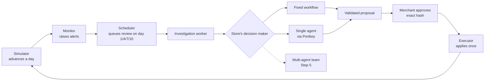

# What we have built so far (Steps 1–4)

*Written 2026-11-25. Demo: Dec 3. Report: Dec 10.*

This explains, in plain words and with real examples from our runs, what the project does and
what each finished step added. Numbers come from the actual development runs on M5 data.
Examples marked *illustrative* show the real shape of the data with simplified values.

---

## 1. The project in one paragraph

We run a **simulated online store** (10 real products from the Walmart M5 sales dataset, one
warehouse, two suppliers) for **28 days**. On four **review days** (days 1, 4, 7, 10) a decision
maker looks at the store and decides whether to **reorder stock**, **change prices**, or **do
nothing**. A (simulated) merchant must approve every change before it happens. We compare three
decision makers on exactly the same situations:

| Arm | Who decides | Status |
|---|---|---|
| **Fixed workflow** | A fixed recipe: forecast → compare plans → validate → propose | Done (Step 3) |
| **Single agent** | One AI model (gpt-5-nano via Portkey) choosing its own tool steps | Done (Step 4) |
| **Multi-agent team** | A supervisor plus inventory and pricing specialists | Next (Step 5) |

The question for the report: *does letting an AI adapt its investigation make better business
decisions than a fixed numerical recipe, and is a team better than a single agent?* "No, it is
not better" is an acceptable answer — what matters is a fair, measured comparison.

### The store, concretely

- Suppliers: `supplier-fast` (stock arrives in **3 days**) and `supplier-standard` (**7 days**).
- Starting cash: **$2,000**. Each purchase order costs a **$5** fee plus the goods.
- Rules (the "policy"), enforced by code, never by the AI:
  - price must stay within **90–110 %** of the product's reference price;
  - at least **20 % gross margin**;
  - a product's price can change at most **once every 3 days**;
  - orders come in **multiples of 5**, between **5 and 200** units.

Example: `HOUSEHOLD_1_344` has reference price $7.93 and cost $4.36. Its allowed price range is
$7.14–$8.72 (90–110 %), and the margin rule (cost ÷ 0.8 = $5.45) does not tighten it further.
On day 1 both decision makers proposed raising it to **$8.72**, the top of the range.

### Three scenario families

| Scenario | What happens | Why it matters |
|---|---|---|
| `normal` | Ordinary demand | Baseline |
| `demand_surge` | From day 4, demand doubles for 5 days | Can the decision maker react to a spike? |
| `supplier_delay` | From day 4, orders arrive 3 days late | Can it notice late deliveries and compensate? |

---

## 2. What existed before we started

The repository already had the **foundation** (Phases 1–2):

- the simulator (demand, sales, stock, deliveries, cash, profit);
- numerical **tools**: store snapshot, sales history, supplier status, demand forecast,
  plan comparison (simulates candidate bundles and ranks them by expected profit), validation;
- a PostgreSQL database with **row-level security** — every program logs in with its own
  restricted account and can only see its own store;
- the **approval path**: a proposal is stored unchangeably, the merchant approves its exact
  content (by hash), and a separate **executor** applies it exactly once.

What was missing: nothing happened **on its own**. A merchant had to ask a question to start an
investigation, and there was no AI agent at all.

---

## 3. Step 1 — The monitor (proactive alerts)

**Branch:** `phase-3a-monitoring` · **Plain idea:** a watchman that checks the store every day
and raises a flag when something looks wrong.

After each simulated day, the monitor reads the new store state and recent completed sales, then
checks four things:

| Alert | Fires when | Severity |
|---|---|---|
| `stockout_risk` | Stock + incoming orders won't last until a new order could arrive | HIGH if it runs out within the lead time, MEDIUM within lead time + 3 days |
| `supplier_delay` | An order's promised arrival day moved, or it is overdue | — |
| `demand_spike` | Last 3 days sold ≥ 1.5× the forecast, ≥ 5 extra units, **and** above the forecast's 80 % upper band | HIGH at ≥ 2× |
| `overstock` | More than 30 days of stock (clears only below 25 days, so it doesn't flicker) | — |

**Example (illustrative):** `HOUSEHOLD_2_151` has 1 unit in stock, sells about 1 per day and
comes from the 7-day supplier. It will be empty long before a new order could arrive, so the
monitor opens `stockout_risk / HIGH` with the evidence (stock, daily forecast, lead time).

**Design decisions you made:**
- lead time + 3 days as the stockout buffer;
- 1.5× over 3 days for spikes, plus the 80 % band check — this cut false spike alarms from
  **14 % to about 4 %**;
- added the overstock alert with a 30/25-day buffer.

**Safety:** at most one open alert per problem; every change to an alert is kept as a history
event; the monitor's account cannot see the simulator's hidden "true" demand.

**Real count** (fixed workflow, `demand_surge` episode): 15 stockout risks, 4 demand spikes and
3 overstock alerts opened over 28 days.

---

## 4. Step 2 — The scheduler and investigation worker

**Branch:** `phase-3b-scheduling` · **Plain idea:** an alarm clock that starts a review on each
review day, and a worker that carries the review out reliably.

1. **Scheduler**: on days 1, 4, 7, 10 — and only after the monitor has seen today's data — it
   creates exactly one review job, e.g. `review-development-m5-store-day4`, with the open alerts
   attached. Running it twice does nothing the second time (`already_scheduled`).
2. **Investigation worker**: picks up the job under a time-limited **lease**, runs the store's
   assigned decision maker, and records the result: `PROPOSED`, `NO_OP`, `ESCALATED`,
   `TIMED_OUT` or `FAILED`.
3. **Review gate**: the simulated day **cannot advance** while a review is pending or missing.

**Example of the reliability rules:**
- The worker crashes halfway → after the lease expires another worker takes over. The crashed
  worker, if it wakes up, is refused ("lease lost").
- It crashes three times → the job is marked `FAILED` (no endless loop).
- Usage counters (model calls, tokens, tool calls) are saved immediately and **never reset** by a
  retry.

**Design decisions you made:**
- every store runs all 4 reviews;
- the day is blocked until the review finishes;
- the decision maker is fixed per store at setup — it cannot be switched mid-experiment;
- merchant questions are allowed in demo mode but switched off in evaluation, so every arm gets
  identical chances to act.

**Safety:** the scheduler's account can only create review jobs for the current day. It cannot
propose, approve or execute anything.

---

## 5. Step 3 — One complete episode through the real system

**Branch:** `phase-3b-scheduling` (second commit) · **Plain idea:** run a full 28-day store with
every real part connected, the way the evaluation will run it.

Each episode gets a **fresh database**. One driver performs every day in order, each step under
its own restricted login:

```
monitor → scheduler → investigation worker → merchant approval (via the real API)
        → executor → advance the day        (repeat for 28 days)
```

The automated merchant approves every valid proposal. An escalation counts as "no change".

**Real event log** (fixed workflow, `demand_surge`, start of the episode):

```
day 1  monitor        observations=1
day 1  scheduled      alerts=2
day 1  investigation  state=PROPOSED
day 1  approval       status=APPROVED
day 1  execution      executed=True
day 1  advance        → day 2
day 2  monitor        observations=2
day 2  advance        → day 3          (not a review day)
...
day 4  scheduled      alerts=3
day 4  investigation  state=PROPOSED
```

**The important check:** we ran the same scenario two ways — through this full database system,
and through the earlier simple offline simulation — and the results are **identical** for all
three scenarios. That shows the database, logins and approval steps add safety without changing
the business outcome. (To get exact matches we changed the planner's random seed to use the day
instead of the snapshot version — your decision.)

**Fixed workflow results** (one run each, 28 days, "core" = first 14 days):

| Scenario | Profit | Fill rate (share of demand served) |
|---|---|---|
| normal | $415.11 | 0.915 |
| demand_surge | $383.57 | 0.663 |
| supplier_delay | $355.95 | 0.988 |

Each run: 4 proposals, 4 executions, about 3 seconds.

---

## 6. Step 4 — The single AI agent

**Branch:** `phase-3d-single-agent` · **Plain idea:** replace the fixed recipe with an AI that
decides for itself which tools to use, but keep all numbers, rules and approvals out of its hands.

### How one review works

1. The agent receives the **objective**, today's **alerts**, and a **compact store table**
   (stock, incoming units, price, cost, allowed price range, whether the price is locked).
2. It calls tools as it sees fit: `forecast_demand`, `compare_plans`, `get_sales_history`,
   `get_supplier_status`, `validate_plan`.
3. It finishes with **`submit_decision`**: `proposal` (with actions), `no_op`, or `escalation`.
4. The system checks the submission before accepting it:
   - no decision without evidence (it must have forecast or compared plans);
   - it may only act on products it actually forecast;
   - every proposal is run through `validate_plan`; if it breaks a rule, it is rejected and the
     agent is told why, so it can fix it.
5. An accepted proposal goes through the **same** approval and executor path as the fixed arm.

**Example conversation** (*illustrative*, matching the real structure):

```
→ Agent receives: day 4, alerts: stockout_risk HIGH on HOUSEHOLD_1_397, store table…
← Agent calls:    forecast_demand(skus=[all 10])
→ Tool replies:   HOUSEHOLD_1_397 next7_units 9.0, next14_units 18.0 (80% band 12–25) …
← Agent calls:    compare_plans(skus=[all 10])
→ Tool replies:   recommended: raise HOUSEHOLD_1_397 to 291¢ and order 10;
                  expected profit $212 vs $185 with no change …
← Agent calls:    submit_decision(proposal,
                    "Stockout alert on HOUSEHOLD_1_397; compare_plans shows a gain.
                     Ordering 15 instead of 10 to cover the upper forecast band.",
                    actions=[set_price 291¢, order 15 units, …])
→ System:         validated ✓ → stored as PENDING → merchant approves → executor applies it
```

That "15 instead of 10" is what **adaptive** means here. In the real normal-scenario day-4
review, the agent proposed ordering **15** units each of `HOUSEHOLD_1_397` and
`HOUSEHOLD_1_271` — it adjusted the bundle rather than copying it.

**Example of a rejected submission** (from the automated tests):

```
← submit_decision(proposal, actions=[set_price SYNTH-001 to 1¢])
→ {"accepted": false, "error": "proposal failed validation:
    price_range: price outside policy range; margin: price violates minimum gross margin"}
← submit_decision(no_op, "Stock covers demand.")       → accepted
```

### Budget and safety

Every review has a hard budget (frozen by you after the pilot):

| Limit | Cap |
|---|---|
| Model calls | 6 |
| Input tokens (total) | 18,000 |
| Output tokens incl. reasoning | 3,000 (max 1,200 per call) |
| Tool calls | 12, of which at most 3 plan comparisons |
| Time | 90 seconds |

- On the **last allowed call** the model is forced to submit. If it still can't, the review is
  **escalated** to the merchant — never a silent failure.
- Each model call is **counted before it is sent**. If the worker dies mid-call, the retry
  charges that call at its full 1,200-token ceiling, because we can't know whether the provider
  billed it.
- Every step is saved. A retry **rebuilds the conversation** and continues — it does not repeat
  tools, re-pay for earlier calls, or reset budgets.
- Gateway errors are retried once. A second failure ends the attempt, visibly recorded.

**Your design decisions:** the agent may edit the ranked bundle but must validate it; keep the
documented caps and freeze them after the pilot; reasoning effort `low`; resume from checkpoint.

### Pilot results (12 real reviews on M5 data)

| Scenario | Fixed: profit / fill rate | Single agent: profit / fill rate |
|---|---|---|
| normal | $415.11 / 0.915 | $421.21 / 0.909 |
| demand_surge | $383.57 / 0.663 | $375.86 / 0.650 |
| supplier_delay | $355.95 / 0.988 | $360.83 / 0.973 |

- 12 of 12 reviews ended in a validated, approved, executed proposal. There were no errors,
  timeouts or budget run-outs.
- Per review: 3–5 model calls, 8.2k–15.8k input tokens, 0.9k–1.7k output tokens, 5–6 tools.
- Total cost: about **1.5 US cents**. Each episode took 38–52 seconds.
- These are single runs, so the differences are noise. The real comparison is the 270-run
  evaluation.

---

## 7. How a review day flows now (all parts together)



Each box logs in with its own restricted account. Only the merchant can approve, and only the
executor can change the store.

---

## 8. Testing

- **176 automated tests**, all passing. They use a real PostgreSQL database; the agent tests use a
  scripted fake model, so they are free and repeatable.
- Highlights:
  - one alert per problem;
  - review scheduled exactly once;
  - crash / lease-takeover / retry limit;
  - no duplicate proposals after a crash;
  - the full system matches the offline simulator;
  - agent: grounded proposal, rejected-then-corrected submission, budget exhaustion → escalation,
    tool caps, crash mid-call → resume with conservative billing, gateway errors visible.

---

## 9. Git

All branches are pushed to `harenshylak/Ecommerce-Decision-Agent`:

```
981cd53  Step 1  monitor and alerts                    (phase-3a-monitoring)
c45ed7d  Step 2  scheduled reviews and workers         (phase-3b-scheduling)
874d0af  Step 3  full persisted episode                (phase-3b-scheduling)
7c36a2b  Step 4  single adaptive agent                 (phase-3d-single-agent)
```

The branches build on each other, so one pull request from `phase-3d-single-agent` into `main`
contains everything.

---

## 10. What is left

| Step | What | Plain idea |
|---|---|---|
| 5 | Multi-agent team | A supervisor asks an inventory specialist and a pricing specialist, then combines one proposal under shared cash; the same total budget as the single agent |
| 6 | Hosted React app | A merchant screen for the demo: alerts, proposals, approve or reject |
| 7 | Evaluation | A development comparison, then the frozen 30 scenarios × 3 replicates × 3 arms = 270 episodes |
| 8 | Report | Due Dec 10 |

Findings already worth putting in the report:
- The spike band check cut false alarms from 14 % to about 4 %.
- Overstock alerts churn early in an episode. This is because the day-1 forecast uses the last
  4 weeks of sales, while the simulator's demand uses a long-run weekday average.
- The full system reproduces the offline results exactly.
- The pilot's cost and token profile is in Section 6.

---

## Glossary

- **Snapshot**: the store's current public state: stock, prices, cash and open orders.
- **Proposal**: a set of actions waiting for merchant approval. It can't be changed once stored.
- **Lease**: a time-limited claim on a job, so two workers never do the same review.
- **Escalation**: "a human should look at this". It counts as no change in experiments.
- **Fill rate**: units sold ÷ units customers wanted.
- **Core / extended**: results for the first 14 days / for all 28 days.
- **Portkey**: the course's gateway to the OpenAI model; the key lives only in `.env`.
